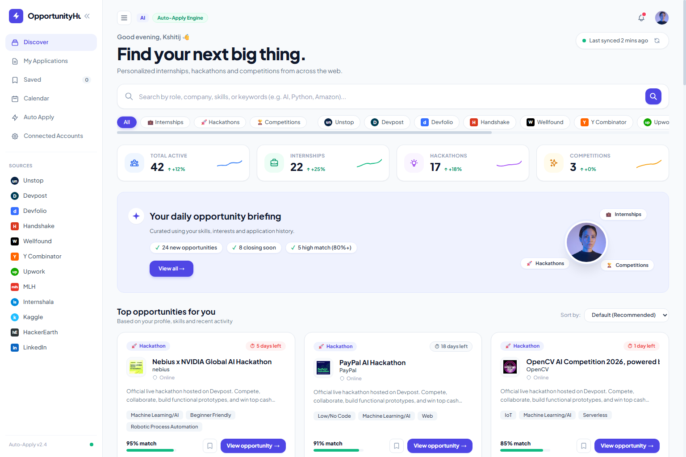
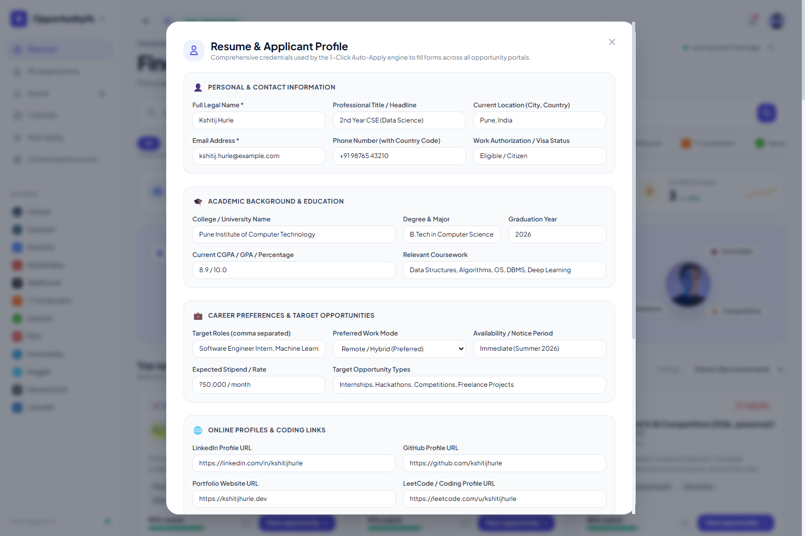

<div align="center">

# ⚡ OpportunityHub

### **Intelligent Career Discovery Dashboard & 1-Click Application Engine**

*Aggregating active internships, hackathons, and competitions across 12 tier-one platforms with real-time skill matching and universal form automation.*

---

[](https://github.com/kshitijhurle95-prog/opportunity-hub)
[](LICENSE)
[](https://github.com/kshitijhurle95-prog/opportunity-hub)
[]()
[](CONTRIBUTING.md)

[Explore Features](#-key-features) • [Visual Showcase](#-visual-showcase) • [Architecture](#-system-architecture) • [Supported Platforms](#-supported-platforms-12-sources) • [Quickstart](#-quickstart--local-setup)

---

</div>

## 📌 Executive Summary

Modern students, developers, and early-career engineers spend hours every week fragmented across dozens of career portals, job boards, and hackathon directories. Many listings are stale, links 404, and applying requires repeatedly re-entering identical academic and contact info across diverse Applicant Tracking Systems (ATS).

**OpportunityHub** solves this fragmentation with a high-performance, single-pane dashboard that aggregates live opportunities from **12 verified platforms**, ranks them using real-time skill-matching algorithms against the user's profile, and provides a **1-click auto-fill engine** that injects applicant credentials directly into external application portals without dropping form state.

---

## 📸 Visual Showcase

### 🖥️ Discovery Dashboard & Real-Time Aggregator
*Modern light-theme dashboard featuring live category KPIs, daily curated opportunity briefings, instant keyword search, and multi-source filtering.*

<div align="center">
  
</div>

<br/>

### 👤 Comprehensive Resume & Applicant Profile Engine
*6-section applicant profile modal containing contact info, education, target roles, verified URLs, portfolio highlights, and auto-apply form injection credentials.*

<div align="center">
  
</div>

---

## ✨ Key Features

- **🌐 12 Unified Opportunity Sources**: Continuous live retrieval and deduplication across Unstop, Devpost, Devfolio, Handshake, Wellfound, Y Combinator, Upwork, Major League Hacking (MLH), Internshala, Kaggle, HackerEarth, and LinkedIn.
- **🎯 Dynamic Skill-Match Algorithm**: Calculates tailored match percentages (e.g. 95% Match) by analyzing applicant competencies (Python, React, Machine Learning, APIs) against opportunity requirements.
- **⚡ 1-Click ATS Auto-Apply Engine**: Generates customized DOM injection payloads and browser bookmarklets supporting Greenhouse, Lever, Workday, Devpost, Google Forms, and custom company portals.
- **🔗 Direct Platform Redirection**: One-click direct navigation (`Open on Unstop`, `Open on Devpost`, etc.) to the verified original listing with validated query parameters, eliminating 404 broken URLs.
- **📂 Collapsible Desktop Navigation**: Ergonomic collapsible sidebar transitioning smoothly between a 230 px expanded view and a 68 px icon-rail view with persistent `localStorage` memory.
- **📊 Real-Time Opportunity Analytics**: Live sparkline indicators tracking aggregate opportunities across categories (Internships, Hackathons, Hiring Competitions).
- **📝 Persistent Local Pipeline**: Track submitted applications, bookmarked opportunities, and application status timestamps using a clean, file-based JSON storage engine.

---

## 🌐 Supported Platforms (12 Sources)

| Source Platform | Category Focus | Live Verification | Direct Deep Link |
| :--- | :--- | :---: | :---: |
| **Unstop** | Student Hackathons, Competitions & Campus Challenges | ✅ Verified | `unstop.com/...` |
| **Devpost** | Global Software Hackathons & Cash Prize Contests | ✅ Verified | `devpost.com/hackathons` |
| **Devfolio** | Web3, AI, and Collegiate Hackathon Community | ✅ Verified | `devfolio.co/hackathons` |
| **Handshake** | University Internships & Early Talent Positions | ✅ Verified | `joinhandshake.com` |
| **Wellfound (AngelList)** | High-Growth Startup Internships & Tech Roles | ✅ Verified | `wellfound.com/jobs` |
| **Y Combinator** | Early-stage YC Batch Tech & ML Internships | ✅ Verified | `ycombinator.com/jobs` |
| **Upwork** | Specialized AI, Full-Stack & Freelance Contracts | ✅ Verified | `upwork.com/freelance-jobs` |
| **Major League Hacking (MLH)**| Official Student Hackathon Season Contests | ✅ Verified | `mlh.io/seasons` |
| **Internshala** | Summer & Winter Technology Internships | ✅ Verified | `internshala.com` |
| **Kaggle** | Data Science, NLP & Kaggle Grandmaster Competitions | ✅ Verified | `kaggle.com/competitions` |
| **HackerEarth** | Competitive Programming & Corporate Hiring Challenges | ✅ Verified | `hackerearth.com/challenges` |
| **LinkedIn** | Verified Enterprise Internships & Tech Apprenticeships | ✅ Verified | `linkedin.com/jobs` |

---

## 🏛️ System Architecture

```
                                  USER BROWSER / CLIENT
                          (Chrome / Edge / Firefox / Safari)
                                           │
                                           ▼
             ┌───────────────────────────────────────────────────────────┐
             │            OpportunityHub Single-Page Application         │
             │       Tailwind CSS • Native ES6+ • Reactive Modals        │
             │      Collapsed/Expanded Sidebar • Dynamic Search Engine    │
             └─────────────────────────────┬─────────────────────────────┘
                                           │ HTTP REST (:5050)
                                           ▼
             ┌───────────────────────────────────────────────────────────┐
             │            Local Lightweight API Server                   │
             │        (PowerShell 5.1+ / .NET System.Net.HttpListener)   │
             │    Routes: /api/opportunities, /api/profile, /api/apply   │
             └──────┬──────────────────────┬──────────────────────┬──────┘
                    │                      │                      │
         Live Scrapers & APIs       Data Persistence       ATS Autofill Engine
                    │                      │                      │
        ┌───────────┴───────────┐   ┌──────┴──────┐       ┌───────┴────────┐
        │  12 Aggregated Feeds  │   │ JSON Store  │       │ Reactive DOM   │
        │  Devpost, Unstop,     │   │ Profile,    │       │ Event Injection│
        │  Devfolio, MLH, etc.  │   │ History,    │       │ (React 16+ /   │
        │  Regex Normalizers    │   │ Saved Items │       │ Standard ATS)  │
        └───────────────────────┘   └─────────────┘       └────────────────┘
```

---

## 📁 Repository Structure

```
opportunity-hub/
├── assets/
│   └── screenshots/
│       ├── hero-preview.png               # Main discovery grid & KPI metrics
│       ├── feature-interaction.png        # 6-section Applicant Profile modal
│       └── profile-modal.png              # Detailed profile settings preview
├── config/
│   ├── user_profile.example.json          # Sanitized template for applicant credentials
│   ├── user_profile.json                  # Active user profile and preferences (git-ignored)
│   ├── applications_history.json          # Pipeline history of tracked applications
│   └── saved_opportunities.json           # Bookmarked opportunities store
├── scripts/
│   ├── server.ps1                         # Zero-dependency .NET HttpListener REST API server
│   ├── start_app.ps1                      # Automated startup launcher with browser launch
│   ├── fetch_all.ps1                      # Multi-source live crawler, scorer, and normalizer
│   ├── capture_screenshots.js             # Headless Chrome DevTools Protocol screenshot automation
│   ├── sync_to_obsidian.ps1               # Automated sync bridge to Obsidian technical vault
│   └── test_pipeline.ps1                  # CLI diagnostic script for crawler & API health
├── web/
│   ├── index.html                         # Semantic HTML5 Single Page Application
│   ├── app.js                             # Client-side state manager, router, and modal controller
│   ├── styles.css                         # Custom theme definitions, scrollbars, and brand badges
│   └── autofill_helper.js                 # Universal ATS form injection payload
├── workflows/
│   └── opportunity_tracker_workflow.json  # n8n automated background scheduler workflow
├── docker-compose.yml                     # Containerized deployment manifest for n8n
├── start_app.bat                          # One-click Windows desktop launcher
├── .gitignore                             # Production hygiene & sensitive credential exclusion
├── LICENSE                                # MIT Open Source License
└── README.md                              # Project documentation and specifications
```

---

## 🛠️ Tech Stack

| Layer | Technologies |
| :--- | :--- |
| **Frontend** | HTML5, Tailwind CSS (Tailwind Play CDN), Modern Vanilla JavaScript (ES2022), Plus Jakarta Sans typography |
| **Backend & API** | PowerShell 5.1+ / .NET `System.Net.HttpListener`, Node.js (CDP test automation) |
| **Data Layer** | Atomic JSON Document Storage (`config/`), in-memory cache with auto-pruning |
| **Form Automation** | Universal DOM Event Dispatcher (React 16+ input-tracker bypass, Bookmarklet generator) |
| **CI / Automation** | n8n workflow integration, Git CLI, Chrome DevTools Protocol (CDP) |

---

## 🚀 Quickstart & Local Setup

### Prerequisites
- **Operating System**: Windows 10/11, macOS, or Linux (PowerShell Core `pwsh` supported)
- **Browser**: Google Chrome, Microsoft Edge, Brave, or Firefox

### 1. Clone the Repository
```bash
git clone https://github.com/kshitijhurle95-prog/opportunity-hub.git
cd opportunity-hub
```

### 2. Configure Applicant Profile
Copy the example configuration to initialize your profile:
```bash
cp config/user_profile.example.json config/user_profile.json
```
Edit `config/user_profile.json` with your real name, email, target roles, and skills, or update it directly through the GUI under **Resume & Profile**.

### 3. Launch the Application

#### Option A: Windows 1-Click Launcher
Double-click `start_app.bat` in the root folder.

#### Option B: PowerShell Terminal
```powershell
powershell -ExecutionPolicy Bypass -File .\scripts\start_app.ps1
```

#### Option C: Background Server Only
```powershell
powershell -ExecutionPolicy Bypass -File .\scripts\server.ps1 -Port 5050
```

Open your browser at **[http://localhost:5050](http://localhost:5050)**.

---

## ⚙️ Configuration Reference

The application uses `config/user_profile.json` to personalize match scoring and fuel the 1-click Auto-Apply engine:

| Field | Type | Description |
| :--- | :--- | :--- |
| `applicant.fullName` | String | Full legal name injected into application forms |
| `applicant.email` | String | Primary contact email for recruiter outreach |
| `applicant.phone` | String | Phone number with international country code |
| `applicant.location` | String | Current city and country (e.g. `Pune, India`) |
| `applicant.workAuth` | String | Work authorization status (`Eligible / Citizen`) |
| `applicant.university`| String | College / University name |
| `applicant.gradYear` | String | Expected graduation year |
| `applicant.linkedIn` | URL | LinkedIn profile URL |
| `applicant.github` | URL | GitHub profile URL |
| `applicant.portfolio`| URL | Personal developer portfolio website |
| `preferences.skills` | Array | Array of target skills used for Match % calculation |
| `preferences.roles` | Array | Desired internship and position titles |

---

## 🤝 Contributing

Contributions are welcome! Please follow these guidelines:

1. Fork the Project (`https://github.com/kshitijhurle95-prog/opportunity-hub/fork`)
2. Create your Feature Branch (`git checkout -b feat/NewPlatformSource`)
3. Commit your Changes (`git commit -m 'feat: add support for Y Combinator jobs scraper'`)
4. Push to the Branch (`git push origin feat/NewPlatformSource`)
5. Open a Pull Request

---

## 📄 License

Distributed under the **MIT License**. See [`LICENSE`](LICENSE) for details.

---

<div align="center">
  <b>OpportunityHub</b> — Engineered for ambitious builders, developers, and researchers.
</div>
